# BankServices – Banking Management Application

BankServices is a full-stack web application for managing a retail bank: **clients**, **current and savings accounts**, **deposits / withdrawals / transfers** and **bill payments**, with two roles (**administrator** and **client**).

| Layer    | Technology |
|----------|------------|
| Backend  | Java 21 · Spring Boot 4.1 (Web MVC, Data JPA, Security, Validation, Mail) · JWT · Flyway · Bucket4j |
| Frontend | React 19 · Vite 8 · Material UI 9 · Tailwind CSS 4 · React Router 7 · Axios |
| Database | MySQL 8 |
| Tests    | JUnit 5 · Mockito · AssertJ · MockMvc · H2 (backend) — Vitest · Testing Library (frontend) |

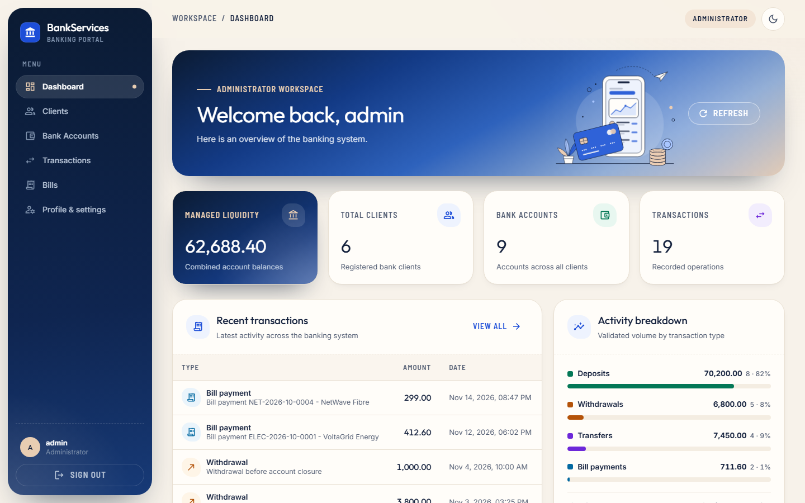

---

## Contents of the repository

```
Bank_Services/
├── backend/                      Spring Boot REST API (Maven project, port 8080)
│   ├── src/main/java/...         controller · service · repository · entity · dto · config · ...
│   ├── src/main/resources/
│   │   ├── application.properties
│   │   ├── application-demo.properties   "demo" profile (loads the fictitious data)
│   │   ├── db/migration/          Flyway schema migrations V1..V3
│   │   └── db/demo/               V100__demo_data.sql (fictitious data)
│   ├── src/test/java/...          451 automated tests
│   ├── .env.example               configuration template
│   └── mvnw, mvnw.cmd             Maven wrapper (no Maven installation needed)
├── frontend/                     React single-page application (port 5173)
├── database/
│   ├── schema.sql                database schema (DDL of the 8 tables)
│   ├── er-diagram.png / .svg     entity-relationship diagram
│   └── seed_data.sql             fictitious test data (manual load)
└── docs/
    ├── report/BankServices_Report.pdf   project report (8 pages)
    ├── uml/                      UML class diagram (.png, .svg, PlantUML .puml, Mermaid .mmd)
    └── screenshots/              screenshots of the application
```

---

## Features

**Administrator** – dashboard with global indicators · create / update / delete clients · register a client and send an activation e-mail · open current accounts (with authorised overdraft) and savings accounts (with interest rate) · close / reopen accounts · deposits, withdrawals and transfers · issue, search and cancel bills.

**Client** – account activation through a one-time link · personal dashboard · accounts and full transaction history · deposits, withdrawals and transfers between own accounts · unpaid / paid / overdue bills, online bill payment and receipts · password reset.

**Business rules** – a debit is refused below `-overdraft` (0 for savings accounts) · closed accounts cannot be used and can only be closed with a zero balance · a bill can be paid only once · balances are updated under pessimistic row locks inside a single database transaction · a client can only access their own data.

---

## Prerequisites

| Tool | Version | Check |
|------|---------|-------|
| JDK  | 21 or newer | `java -version` |
| Node.js + npm | Node 20.19+ (22 LTS recommended) | `node -v` |
| MySQL Server | 8.x, running on `localhost:3306` | `mysql --version` |

Maven does **not** need to be installed: the project ships with the Maven wrapper (`mvnw` / `mvnw.cmd`).

---

## Installation and execution

### 1. Clone the repository

```bash
git clone https://github.com/<your-account>/Bank_Services.git
cd Bank_Services
```

### 2. Configure the backend

Copy the configuration template and fill in your MySQL password and a JWT key:

```bash
cd backend
cp .env.example .env          # Windows (cmd): copy .env.example .env
```

```properties
DB_USERNAME=root
DB_PASSWORD=your-mysql-password
JWT_SECRET=<Base64 key, at least 32 bytes - the template contains a working demo key; generate your own with: openssl rand -base64 48>
MAIL_USERNAME=                # optional (Gmail address + app password) - e-mails are skipped if empty
MAIL_PASSWORD=
```

The `.env` file is read automatically at start-up and is ignored by Git. (You can also set these values as environment variables.)

### 3. Start the backend **with the demo data** (recommended)

The `demo` profile creates the database `bank_services_demo` automatically, builds the schema with Flyway and loads the fictitious dataset.

```bash
# Linux / macOS / Git Bash
SPRING_PROFILES_ACTIVE=demo ./mvnw spring-boot:run

# Windows PowerShell
$env:SPRING_PROFILES_ACTIVE="demo"; .\mvnw.cmd spring-boot:run

# Windows cmd
set SPRING_PROFILES_ACTIVE=demo
mvnw.cmd spring-boot:run
```

The API is ready when the log shows `Started BankservicesApiApplication`. It listens on **http://localhost:8080/api**.

> Without the `demo` profile (`./mvnw spring-boot:run`), the application uses an empty database named `bankservices` (created automatically). To create the first administrator in that case, set `ADMIN_USERNAME` and `ADMIN_PASSWORD` as environment variables before starting, or load `database/seed_data.sql` (see below).

### 4. Start the frontend

In a second terminal:

```bash
cd frontend
npm install
npm run dev
```

Open **http://localhost:5173** and sign in with one of the demo accounts below.

(Optional) To point the frontend to another API URL, copy `frontend/.env.example` to `frontend/.env` and change `VITE_API_BASE_URL`.

### 5. Production build (optional)

```bash
cd backend  && ./mvnw clean package          # -> target/bankservices_api-0.0.1-SNAPSHOT.jar
java -jar target/bankservices_api-0.0.1-SNAPSHOT.jar --spring.profiles.active=demo
cd frontend && npm run build                  # -> dist/ (static files)
```

---

## Fictitious test data

All names, e-mails, phone numbers, providers and amounts are invented. The dataset contains **6 clients, 7 logins, 9 accounts, 19 transactions, 9 bills and 2 bill payments**, with balances consistent with the transaction history.

| Username | Password | Role | What you can test |
|----------|----------|------|-------------------|
| `admin`   | `Admin@2026`  | ADMIN  | Back office: clients, accounts, transactions, bills |
| `amina`   | `Client@2026` | CLIENT | Current + savings account, paid / unpaid / **overdue** bills, transfers |
| `youssef` | `Client@2026` | CLIENT | Client with history and unpaid bill |
| `sara`    | `Client@2026` | CLIENT | Client with unpaid and cancelled bills |
| `karim`   | `Client@2026` | CLIENT | Current account at **-300.00** (overdraft 1,500) and a **closed** savings account |
| `nadia`   | `Client@2026` | CLIENT | Login **disabled** → sign-in refused |
| `omar`    | –             | CLIENT | Login **pending activation** → admin can send the activation e-mail |

Two ways to load it:

1. **Automatic (recommended):** start the backend with the `demo` profile (step 3). The data is applied once by Flyway (`db/demo/V100__demo_data.sql`).
2. **Manual:** start the backend once without the demo profile on an empty database so Flyway creates the tables, then run
   `mysql -u root -p bankservices < database/seed_data.sql`.

To reset the demo, drop the database (`DROP DATABASE bank_services_demo;`) and restart the backend with the `demo` profile.

---

## Running the tests

```bash
# Backend: 451 tests (unit, controller, repository, integration, security) - in-memory H2, no MySQL needed
cd backend
./mvnw test                     # Windows: mvnw.cmd test

# Frontend: 32 tests
cd frontend
npm test
```

Main unit tests of the principal operations (`backend/src/test/java/com/bankservices/bankservices_api/service/`):

| Test class | Operations covered |
|------------|--------------------|
| `TransactionServiceTest` | deposit, withdrawal (with / beyond overdraft), transfer (total money conserved, same account, closed or unknown account, lock order), ownership checks, amount validation |
| `CompteServiceTest` | opening current / savings accounts, closing (zero balance only), reopening |
| `BillPaymentServiceTest` | paying a bill (debit + transaction + PAID + receipt), insufficient funds, double payment, cancelled / foreign bills |
| `ClientServiceTest`, `BillServiceTest` | client CRUD, unique e-mail, bill creation, cancellation, filters, overdue flag |
| `AuthServiceTest`, `JwtServiceTest`, `PasswordResetServiceTest`, `AccountActivationServiceTest` | login, account status, JWT, single-use expiring tokens |

---

## UML class diagram

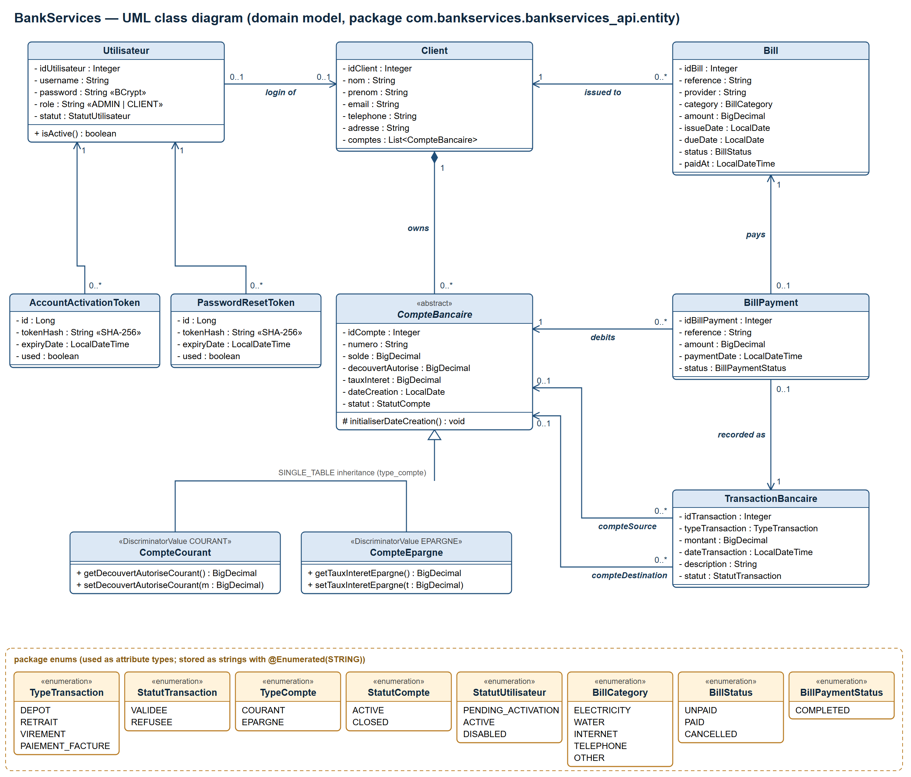

Sources: [`docs/uml/class-diagram.puml`](docs/uml/class-diagram.puml) (PlantUML), [`docs/uml/class-diagram.mmd`](docs/uml/class-diagram.mmd) (Mermaid), [`docs/uml/class-diagram.svg`](docs/uml/class-diagram.svg) (vector), and the layered architecture diagram [`docs/uml/architecture-diagram.puml`](docs/uml/architecture-diagram.puml).

---

## Database schema

MySQL 8 (InnoDB, utf8mb4), **8 tables**. The backend builds the schema itself at startup with the Flyway migrations in `backend/src/main/resources/db/migration` (V1–V3), so you don't need to run any SQL by hand. The complete DDL is in [`database/schema.sql`](database/schema.sql) for reference.

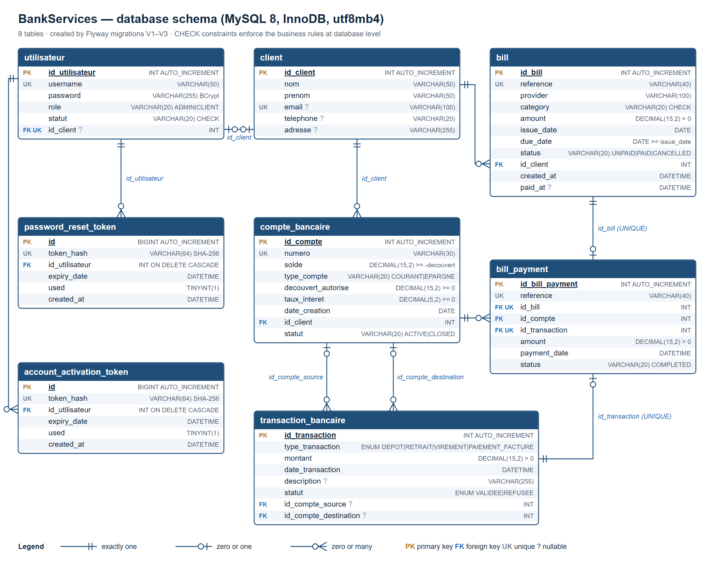

| Table | Role | Key columns and constraints |
|-------|------|-----------------------------|
| `client` | Bank customer | PK `id_client` · `email` UNIQUE |
| `utilisateur` | Online login (ADMIN / CLIENT) | PK `id_utilisateur` · `username` UNIQUE · `password` BCrypt hash · `statut` ∈ {PENDING_ACTIVATION, ACTIVE, DISABLED} · FK `id_client` → client (UNIQUE, NULL for admins) |
| `compte_bancaire` | Current (`COURANT`) and savings (`EPARGNE`) accounts, single-table inheritance | PK `id_compte` · `numero` UNIQUE · FK `id_client` → client · CHECK `solde >= -decouvert_autorise` · overdraft only on COURANT, interest rate only on EPARGNE · `statut` ∈ {ACTIVE, CLOSED} |
| `transaction_bancaire` | Operation history | PK `id_transaction` · `type_transaction` ∈ {DEPOT, RETRAIT, VIREMENT, PAIEMENT_FACTURE} · `montant > 0` · FKs `id_compte_source` / `id_compte_destination` → compte_bancaire (which ones are required depends on the type, enforced by CHECK) |
| `bill` | Bill issued to a client | PK `id_bill` · `reference` UNIQUE · FK `id_client` → client · `amount > 0` · `due_date >= issue_date` · `status` ∈ {UNPAID, PAID, CANCELLED} · `paid_at` set only when PAID |
| `bill_payment` | Successful payment of a bill | PK `id_bill_payment` · FK `id_bill` UNIQUE (a bill can't be paid twice) · FK `id_compte` → compte_bancaire · FK `id_transaction` UNIQUE → transaction_bancaire |
| `password_reset_token` | Password reset links | PK `id` · `token_hash` UNIQUE (SHA-256) · FK `id_utilisateur` ON DELETE CASCADE · `expiry_date`, `used` |
| `account_activation_token` | Account activation links | Same structure as `password_reset_token` |

Flyway also creates its own bookkeeping table, `flyway_schema_history`.

---

## Main REST endpoints

| Method | Endpoint | Role |
|--------|----------|------|
| POST | `/api/auth/login` | public |
| POST | `/api/auth/activate`, `/api/auth/forgot-password`, `/api/auth/reset-password` | public |
| GET/POST/PUT/DELETE | `/api/clients/**` | ADMIN (clients read their own profile) |
| POST | `/api/admin/clients` · `/api/admin/clients/{id}/activation-email` | ADMIN |
| GET/POST/PATCH | `/api/comptes/**` (create, list, `/{id}/close`, `/{id}/reopen`) | ADMIN / owner |
| GET/POST | `/api/transactions/**` (`typeTransaction`: `DEPOT`, `RETRAIT`, `VIREMENT`) | ADMIN / owner |
| GET/POST/PATCH | `/api/admin/bills/**` | ADMIN |
| GET/POST | `/api/client/bills/**` · `/api/client/bills/{id}/pay` · `/api/client/bill-payments/**` | CLIENT |

All protected endpoints require the header `Authorization: Bearer <token>` returned by `/api/auth/login`.

---

## Screenshots

| | |
|---|---|
| 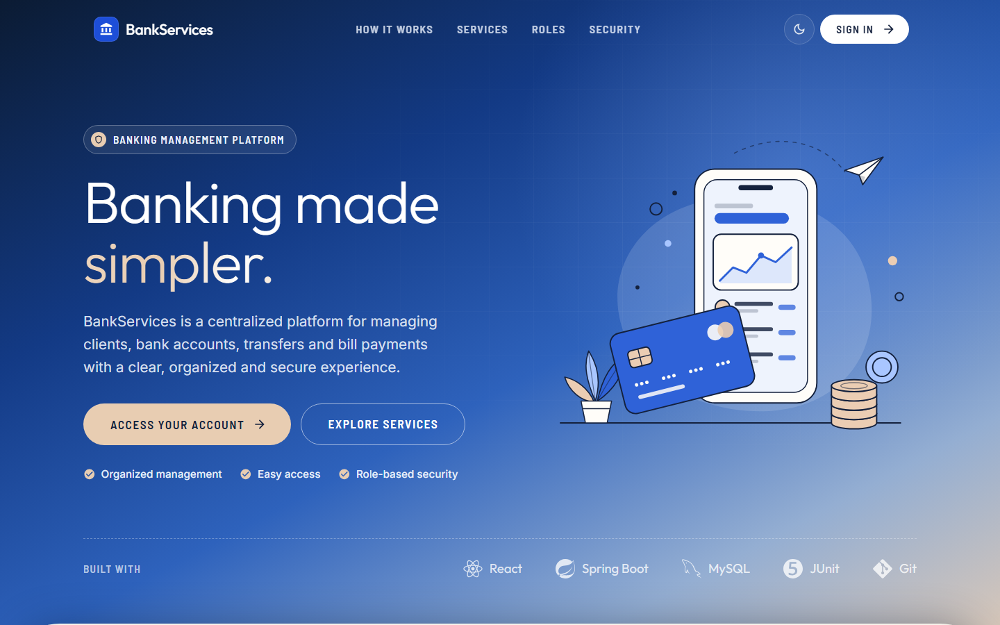 | 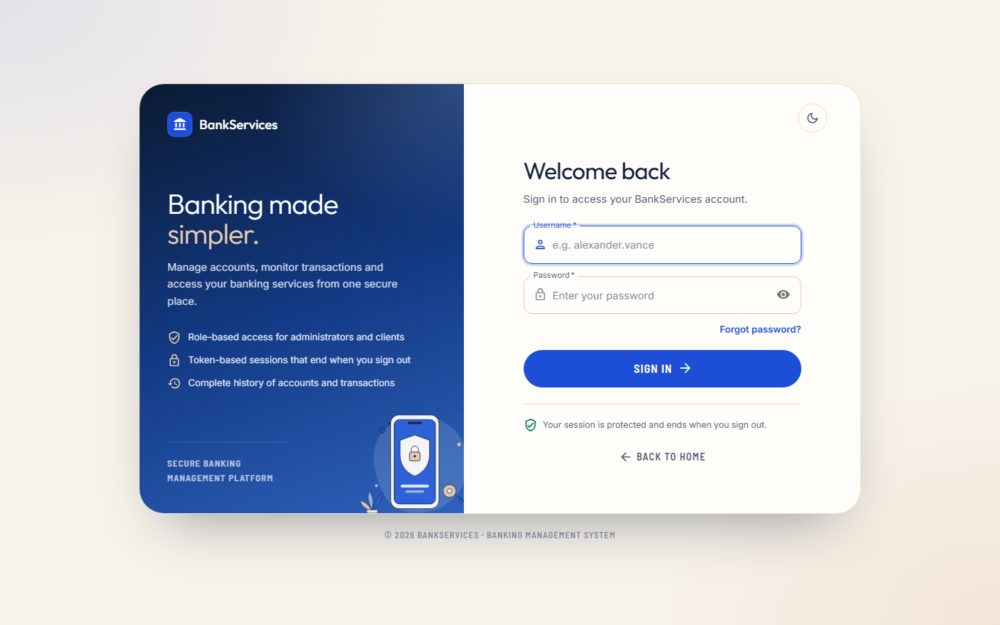 |
| 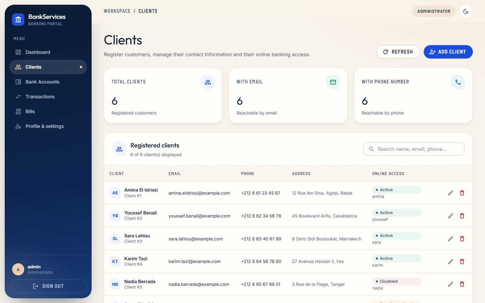 | 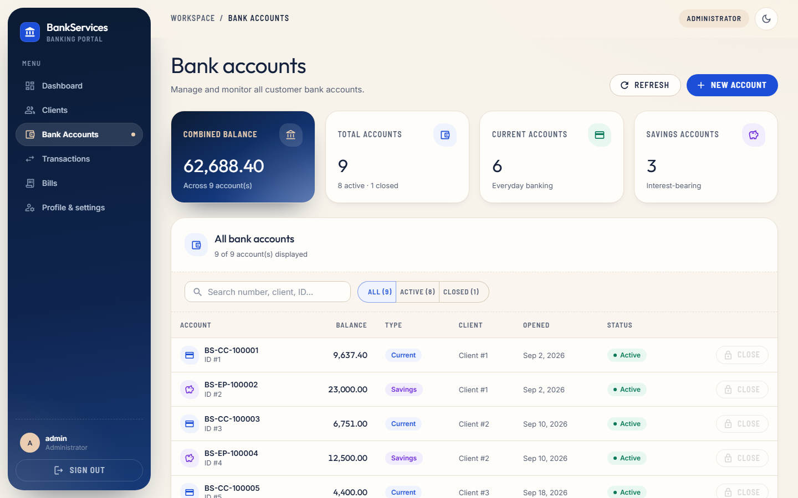 |
| 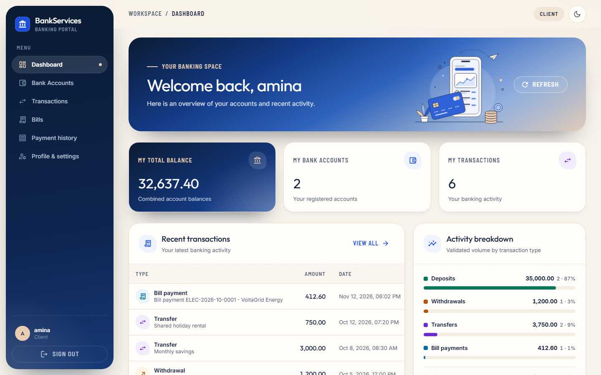 | 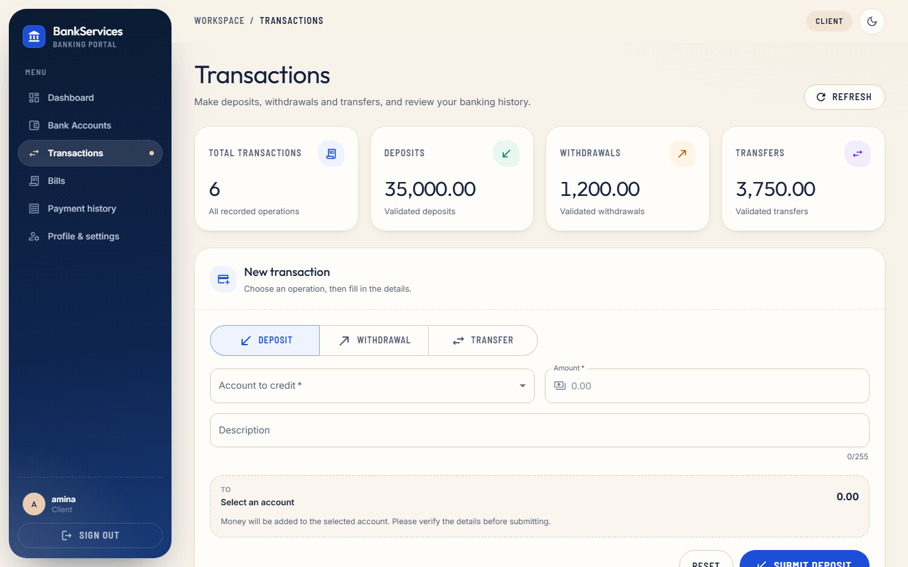 |
| 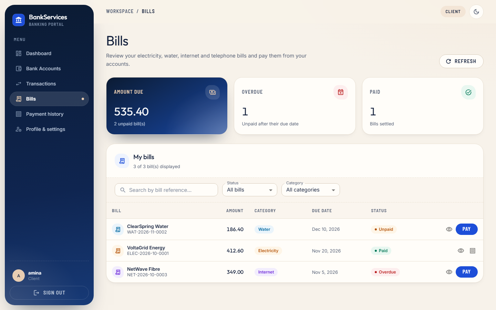 | 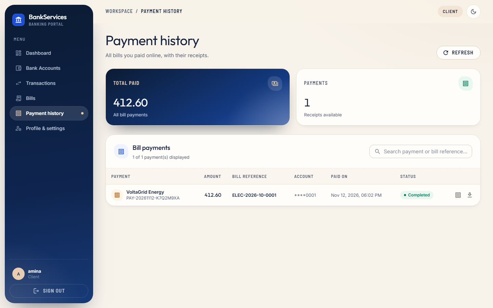 |

---

## Report

The project report — presentation of the application, technical choices, screenshots and a comparative analysis of programming paradigms — is in [`docs/report/BankServices_Report.pdf`](docs/report/BankServices_Report.pdf) (HTML source: `docs/report/report.html`).

## Troubleshooting

| Problem | Solution |
|---------|----------|
| `Access denied for user 'root'` | Check `DB_USERNAME` / `DB_PASSWORD` in `backend/.env`. |
| `Could not resolve placeholder 'JWT_SECRET'` | `backend/.env` is missing or the backend was not started from the `backend/` folder. |
| Port 8080 or 5173 already in use | Stop the other process, or change `server.port` / run `npm run dev -- --port 5175` (allowed CORS origins: 5173, 5175, 5180). |
| Login returns HTTP 429 | Rate limit reached (5 logins per minute): wait for the time given by `Retry-After`. |
| E-mails are not sent | Normal without `MAIL_USERNAME` / `MAIL_PASSWORD`; operations still succeed. |
